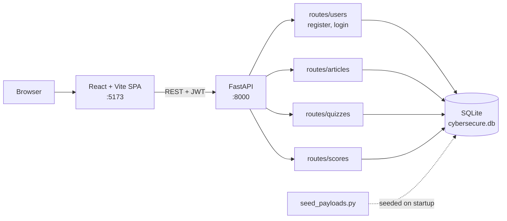

# Cyber Secure: Cybersecurity Awareness Platform

> A small full-stack learning portal: short articles on everyday cyber threats, randomised quizzes, and a personal score history behind JWT login.


<p align="center">
  
</p>

## Contents

- [Overview](#overview)
- [Highlights](#highlights)
- [Architecture](#architecture)
- [Tech stack](#tech-stack)
- [Project structure](#project-structure)
- [Getting started](#getting-started)
- [API](#api)
- [Limitations](#limitations)
- [License](#license)

## Overview

**Problem.** Most people meet phishing, weak passwords and online scams before they ever get security training.

**Approach.** Cyber Secure is a lightweight awareness site. A FastAPI service stores 20 seeded articles and
20 five-question quizzes (100 questions) in SQLite, serves a random quiz per attempt, and records scores for
logged-in users. A React + Vite frontend (scaffolded with Lovable and shadcn/ui) adds pages for safety tips and
incident-reporting guidance.

**Result.** A working local prototype: register and log in, read articles, take quizzes, and see your quiz
history on a dashboard.

## Highlights

- **Content seeded on startup**: tables are created and filled with articles and quizzes from
  `backend/seed_payloads.py` the first time the API starts; there is no separate migration step.
- **JWT auth**: bcrypt password hashing, HS256 tokens with a 24-hour expiry, `Authorization: Bearer` on
  protected routes; users can only read their own score history.
- **Random quizzes**: `GET /quizzes` picks a quiz with `ORDER BY RANDOM()`.
- **Frontend pages**: Home, Learn, Article detail, Tips, Report (how and where to report cyber incidents),
  Quiz, Login, Register and Dashboard.

## Architecture



## Tech stack

| Layer | Technology |
|-------|------------|
| Frontend | React 18, TypeScript, Vite, Tailwind CSS, shadcn/ui (Radix), React Router, TanStack Query |
| Backend | FastAPI, SQLAlchemy, Pydantic, Uvicorn |
| Auth | bcrypt, PyJWT (HS256) |
| Database | SQLite (file created on first run) |

## Project structure

```text
Cyber-Awareness-Platform/
├── backend/
│   ├── main.py             # app factory, CORS, startup seeding, router registration
│   ├── database.py         # SQLite engine and session
│   ├── models.py           # User, Article, Quiz, Question, Score
│   ├── schemas.py          # Pydantic request/response models
│   ├── auth.py             # password hashing, current-user dependency
│   ├── utils/jwt_handler.py
│   ├── routes/             # users, articles, quizzes, scores
│   ├── seed_data.py        # seeding logic
│   ├── seed_payloads.py    # 20 articles + 20 quizzes
│   ├── requirements.txt
│   └── .env.example
├── frontend/
│   ├── src/
│   │   ├── pages/          # Home, Learn, ArticleDetail, Tips, Report, Quiz, Login, Register, Dashboard
│   │   ├── components/     # Navbar, Footer, InfoCard, shadcn/ui primitives
│   │   ├── contexts/       # AuthContext (JWT in localStorage)
│   │   └── assets/
│   ├── package.json
│   └── .env.example
├── LICENSE
└── README.md
```

## Getting started

### Prerequisites

- Python 3.10+
- Node.js 18+ and npm

### Backend (http://localhost:8000)

```bash
cd backend
python -m venv .venv
source .venv/bin/activate          # Windows: .venv\Scripts\activate
pip install -r requirements.txt
cp .env.example .env               # set SECRET_KEY
uvicorn main:app --reload --env-file .env
```

On first start the API creates `cybersecure.db` and seeds it. Interactive docs are at
`http://localhost:8000/docs`. To reset the content, stop the server, delete `cybersecure.db` and start it again.

### Frontend (http://localhost:5173)

```bash
cd frontend
npm install
cp .env.example .env.local         # VITE_API_BASE_URL, defaults to http://localhost:8000
npm run dev
```

The backend's CORS list allows `localhost` on ports 5173, 8080 and 3000; add your origin in `backend/main.py`
if you serve the frontend elsewhere.

## API

<details>
<summary>Endpoints</summary>

| Method | Endpoint | Auth | Description |
|--------|----------|:----:|-------------|
| `POST` | `/register` | | Create a user (name, email, password) |
| `POST` | `/login` | | Returns `{ "token": "<jwt>" }` |
| `GET` | `/articles` | | List articles |
| `GET` | `/articles/{id}` | | Full article |
| `GET` | `/quizzes` | | One random quiz with its questions |
| `POST` | `/submit_quiz` | Yes | Save a quiz score for the current user |
| `GET` | `/scores/{user_id}` | Yes | Score history (only for your own `user_id`) |

Example:

```bash
TOKEN=$(curl -s -X POST localhost:8000/login -H "Content-Type: application/json" \
  -d '{"email":"you@example.com","password":"..."}' | jq -r .token)
curl -H "Authorization: Bearer $TOKEN" localhost:8000/scores/1
```

</details>

## Limitations

- Quiz answers are sent to the browser and the score is computed client-side, so submitted scores are not
  tamper-proof. Server-side grading would be needed for anything beyond self-assessment.
- `SECRET_KEY` falls back to a hard-coded development value when unset; always set it outside local development.
- The Report and Tips pages are static content; nothing is submitted to an authority.
- There is no admin interface: content changes go through `seed_payloads.py`.

## Acknowledgements

Built by Rupesh Bharambe. The frontend was scaffolded with Lovable and shadcn/ui, and ChatGPT was used as a
coding assistant.

## License

Released under the [MIT License](LICENSE).
